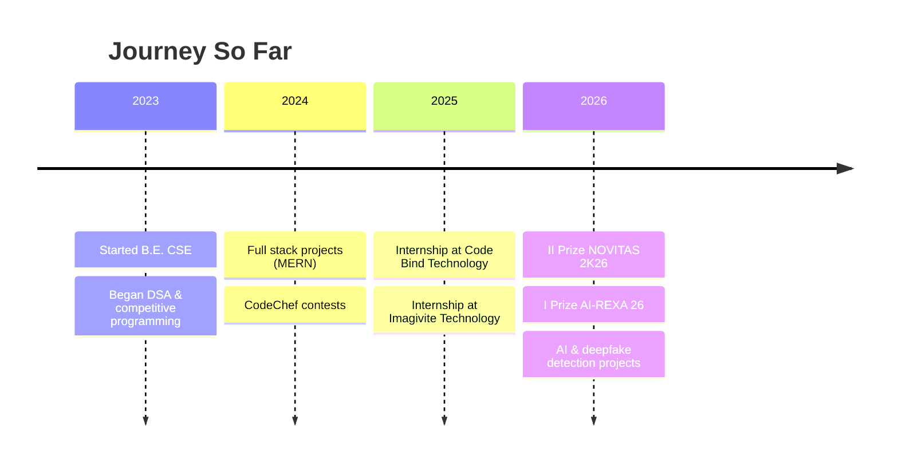
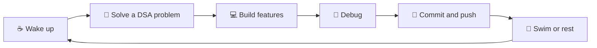

<!-- ============================ HERO ============================ -->
<p align="center">
  
</p>

<p align="center">
  
</p>

<p align="center">
  
</p>

<p align="center">
  
  
  
</p>

<p align="center">
  <a href="mailto:kmjestin25@gmail.com"></a>
  <a href="https://www.linkedin.com/in/jestin-mk-8a403a323/"></a>
  <a href="https://leetcode.com/u/Jestinkm/"></a>
  <a href="https://www.codechef.com/users/jestin25"></a>
  
</p>

<p align="center">
  
</p>

<!-- ============================ ABOUT ============================ -->
## 🌌 About Me


```java
public class Jestin {
    String name      = "Jestin M K";
    String role      = "Full Stack Developer";
    String education = "B.E. CSE @ KSR Institute of Engineering and Technology";
    String[] stack   = {"Java", "Spring Boot", "React", "Node.js", "Flutter", "Firebase", "Python"};
    String[] awards  = {"II Prize - NOVITAS 2K26", "I Prize - AI-REXA 26"};
    String[] hobbies = {"Swimming", "Competitive Programming", "Building useful products"};

    void currentlyBuilding() {
        System.out.println("AI-powered secure systems & deepfake detection apps");
    }
}
```

<br clear="right"/>

- 🎓 **B.E. Computer Science & Engineering**, batch of 2027
- 💼 Production experience from internships at **Code Bind Technology** and **Imagivite Technology Pvt. Ltd.**
- 🔐 Building **AI-powered secure systems** and **deepfake detection applications**
- 🧠 Strong foundation in **Data Structures & Algorithms**
- 🌊 Outside code: **swimming**, contests, and shipping side projects

---

## 🎯 Currently

<table align="center">
<tr>
<td align="center" width="25%">🔭<br/><b>Exploring</b><br/>Deepfake detection &amp; face authentication</td>
<td align="center" width="25%">🌱<br/><b>Learning</b><br/>System design &amp; advanced DSA</td>
<td align="center" width="25%">🛠️<br/><b>Building</b><br/>Full stack + Flutter products</td>
<td align="center" width="25%">🤝<br/><b>Open to</b><br/>Internships, jobs &amp; collabs</td>
</tr>
</table>

---

## 🎮 Developer Character Sheet

<p align="center">
  
  
  
  
</p>

<table align="center">
<tr>
<td width="50%">

**⚔️ Attributes**

<br/>
<br/>
<br/>
<br/>
<br/>


</td>
<td width="50%">

**🎒 Inventory**

- 🗡️ **Weapon:** Java &amp; Spring Boot
- 🛡️ **Armor:** Git &amp; GitHub
- 🧪 **Potion:** Coffee, unlimited refills
- 📜 **Spellbook:** DSA &amp; System Design
- 🧿 **Artifact:** Face-auth &amp; deepfake detection
- 🏅 **Titles:** AI-REXA 26 Champion, NOVITAS 2K26 Runner-up

</td>
</tr>
</table>

---

## 🗺️ Active Quests

| Quest | Type | Status |
|-------|------|--------|
| 🔐 AI-powered secure systems | Main quest |  |
| 🕵️ Deepfake detection app | Main quest |  |
| 📱 Flutter apps with Firebase | Side quest |  |
| 🧩 Reach 1000 LeetCode problems | Grind |  |
| ⭐ Push CodeChef to 5★ | Boss fight |  |

---

## 🛠️ Tech Arsenal

<p align="center">
  
</p>

<details>
<summary><b>🔎 Skills breakdown (click to expand)</b></summary>
<br/>

| Area | Technologies |
|------|--------------|
| 🖥️ **Frontend** | React, HTML5, CSS3, JavaScript, Tailwind, Bootstrap |
| ⚙️ **Backend** | Java, Spring Boot, Node.js, Express, REST APIs |
| 📱 **Mobile** | Flutter, Dart, Firebase |
| 🗄️ **Databases** | MongoDB, MySQL, PostgreSQL, Redis, Firebase |
| 🤖 **AI / ML** | Face recognition, Deepfake detection, Python |
| 🧰 **Tools** | Git, GitHub, Postman, VS Code, Android Studio |

</details>

---

## 🚀 Featured Projects

<table align="center">
<tr>
<td width="33%" align="center">

### 🔐 AI-Based Secure File Access
Face authentication + secure file access + AI verification.

**Java • Firebase**

</td>
<td width="33%" align="center">

### 🛒 E-Commerce Platform
Full-stack shopping platform with Razorpay integration.

**React • Node.js • MongoDB**

</td>
<td width="33%" align="center">

### 📱 Flutter Productivity App
Cross-platform app with a Firebase backend.

**Flutter • Firebase**

</td>
</tr>
</table>

<p align="center">
  <a href="https://github.com/jestinkm?tab=repositories">
    
  </a>
</p>

---

## 🏆 Achievements

<table align="center">
<tr>
<td align="center" width="33%">🥇<br/><b>I Prize</b><br/>AI-REXA 26</td>
<td align="center" width="33%">🥈<br/><b>II Prize</b><br/>NOVITAS 2K26</td>
<td align="center" width="33%">🧩<br/><b>650+ Problems</b><br/>Solved on LeetCode</td>
</tr>
</table>

---

## 💼 Experience Timeline



---

## 📈 Competitive Programming

<p align="center">
  <a href="https://leetcode.com/u/Jestinkm/">
    
  </a>
</p>

<p align="center">
  <a href="https://www.codechef.com/users/jestin25">
    
  </a>
</p>

---

## 📊 GitHub Analytics

<p align="center">
  
  
</p>

<p align="center">
  
</p>

<p align="center">
  
</p>

---

## 🧊 3D Contribution Graph

<p align="center">
  
</p>

> Generated automatically by the workflow in `.github/workflows/profile-animations.yml`.

---

## 🏅 GitHub Trophies

<p align="center">
  
</p>

---

## 🐍 Contribution Snake

<p align="center">
  
</p>

---

## ⚡ Fun Facts

<table align="center">
<tr>
<td align="center" width="25%">🌊<br/><b>Swimmer</b><br/>Debug in the pool, deploy on land</td>
<td align="center" width="25%">☕<br/><b>Fuel</b><br/>Coffee → Code → Commit</td>
<td align="center" width="25%">🏁<br/><b>Contest mode</b><br/>Timer on, brain on</td>
<td align="center" width="25%">🧠<br/><b>Mindset</b><br/>Ship, learn, repeat</td>
</tr>
</table>

---

## 🔁 A Day in the Life



---

## 🧬 Developer Philosophy

```js
const jestin = {
  believes: ["Clean code beats clever code", "Ship early, improve daily", "Every bug is a lesson"],
  motto: () => "Always learning, always building",
  nextMove: async () => await buildSomethingUseful(),
};
```

---

## 💬 Dev Quote of the Moment

<p align="center">
  
</p>

---

## 🌐 Connect with Me

<p align="center">
  <a href="mailto:kmjestin25@gmail.com"></a>
  <a href="https://www.linkedin.com/in/jestin-mk-8a403a323/"></a>
  <a href="https://leetcode.com/u/Jestinkm/"></a>
  <a href="https://www.codechef.com/users/jestin25"></a>
</p>

<p align="center">
  
</p>

<p align="center">
  <a href="mailto:kmjestin25@gmail.com">
    
  </a>
</p>

<p align="center">
  
</p>
